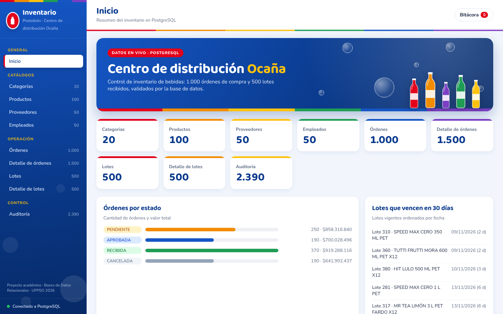
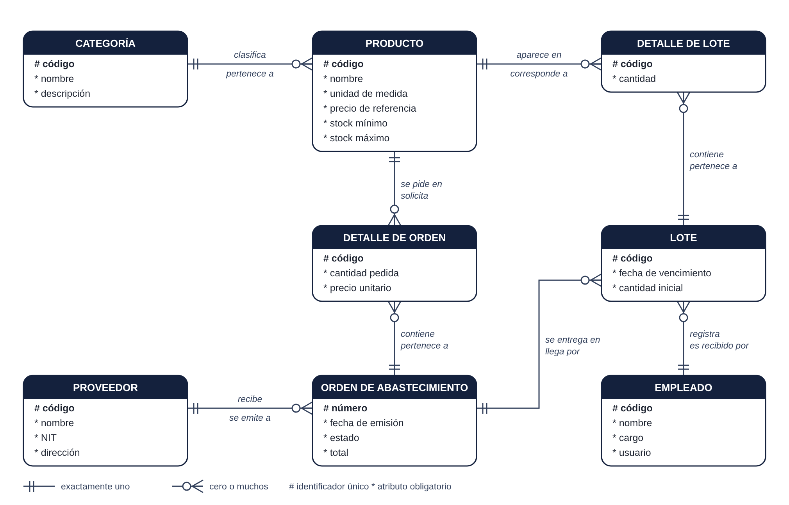
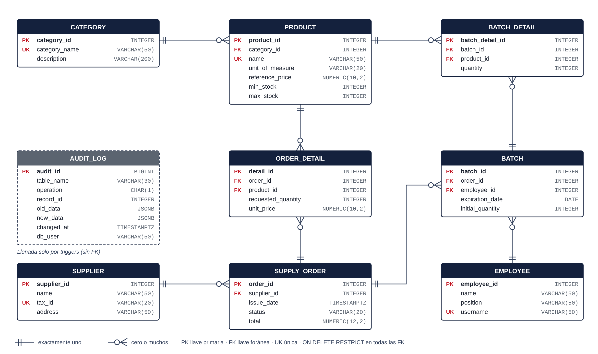
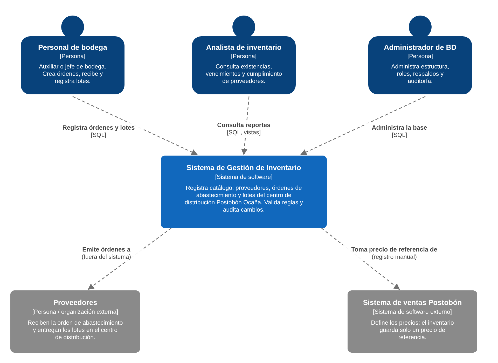
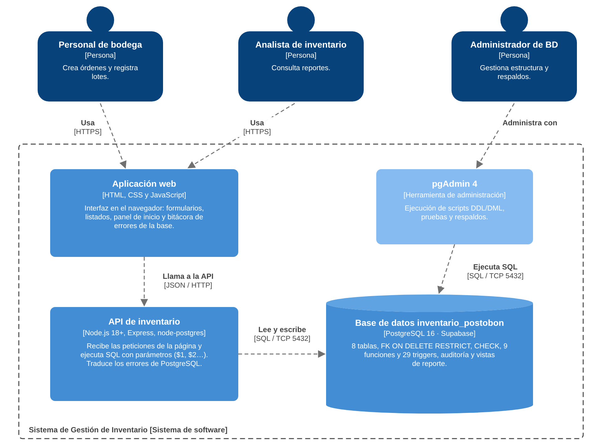

# Inventario Postobón Ocaña

Base de datos relacional en **PostgreSQL** y aplicación web para el módulo de inventario del centro de distribución Postobón en Ocaña (Norte de Santander).

Proyecto de la asignatura **Bases de datos relacionales** — Ingeniería de Sistemas, Universidad Francisco de Paula Santander Ocaña (UFPSO). Docente: Byron Cuesta Quintero.

**Integrantes:** Dairo Julián Parada Reyes (0192288) · Yiceth Yuliana Velásquez Gómez (0192312)

---

## Qué contiene

| Carpeta | Contenido |
| --- | --- |
| `sql/` | Scripts de la base: estructura, triggers, datos, pruebas, consultas, seguridad y validación |
| `app/` | Aplicación web (HTML, CSS y JavaScript + API en Node.js/Express) |
| `datos/` | CSV para importar con `COPY` y el generador de datos sintéticos |
| `docs/` | Documento del proyecto (PDF), diagramas y evidencias del Anexo 1 |

### La base de datos

- 8 tablas de negocio (`category`, `product`, `supplier`, `employee`, `supply_order`, `order_detail`, `batch`, `batch_detail`) y 1 de auditoría (`audit_log`).
- Todas las llaves foráneas con `ON DELETE RESTRICT`: **no hay borrado en cascada**.
- Restricciones `CHECK`, `UNIQUE` e identificadores `GENERATED ALWAYS AS IDENTITY`.
- 9 funciones y 29 triggers: ciclo de vida de las órdenes, total automático, control de lotes, auditoría inalterable y bloqueo de `TRUNCATE`.
- Resiste 62 de 62 intentos de romperla (`sql/04_pruebas_ataque.sql`).

---

## 1. Crear la base de datos

Ejecute los scripts **en este orden** en el Query Tool de pgAdmin (o en el SQL Editor de Supabase):

| # | Archivo | Qué hace |
| --- | --- | --- |
| 1 | `sql/01_ddl.sql` | Crea el esquema `inventario_postobon` y las tablas |
| 2 | `sql/02_triggers.sql` | Crea las funciones y los triggers |
| 3 | `sql/03a_datos_base_ejemplo.sql` | Categorías, proveedores y empleados (o sus propios datos) |
| 4 | `sql/03_datos.sql` | 100 productos, 1.000 órdenes, 1.500 detalles, 500 lotes y 500 detalles de lote |
| 5 | `sql/05_consultas.sql` | Vistas de reporte y consultas de verificación |
| 6 | `sql/07_seguridad.sql` | Roles con permisos mínimos (`consulta_inventario`, `app_inventario`) |
| 7 | `sql/04_pruebas_ataque.sql` | Pruebas: debe mostrar **62 BLOQUEADO y 5 OK** |
| 8 | `sql/08_validacion_datos.sql` | Validación de los datos cargados |

Alternativa a los pasos 3 y 4: `sql/03b_importar_csv.sql` importa los CSV de `datos/csv/` con `COPY`.

## 2. Ejecutar la aplicación web

Requisitos: [Node.js](https://nodejs.org) 18 o superior.

```bash
cd app
npm install
cp .env.example .env      # en Windows: copy .env.example .env
```

Edite `app/.env` con los datos de su base:

- **PostgreSQL local:** `DB_HOST`, `DB_USER`, `DB_PASSWORD`, `DB_NAME`.
- **Supabase:** pegue la cadena *Session pooler* en `DATABASE_URL` y ponga `DB_SSL=true`.

```bash
npm start
```

Abra **http://localhost:3000**. La terminal debe mostrar `Conectado a PostgreSQL`.

> El archivo `.env` tiene la contraseña y **no se sube a GitHub** (está en `.gitignore`).

### Qué hace la aplicación

- **Inicio:** filas por tabla, órdenes por estado, lotes por vencer, productos bajo el mínimo y últimos cambios.
- **Tablas:** listado con búsqueda y paginación; crear, editar y eliminar.
- **Órdenes:** cambio de estado y acceso a sus productos y lotes.
- **Errores visibles:** si la base rechaza una operación (precio negativo, borrado con registros relacionados…), la página muestra la restricción que lo impidió. Las reglas las aplica la base de datos, no la página.
- **Bitácora:** cada operación de la sesión, aceptada o rechazada.

Todas las consultas usan parámetros (`$1`, `$2`…), lo que impide la inyección SQL.



## 3. Publicar la página en internet (opcional)

La aplicación se puede publicar gratis en [Render](https://render.com) usando la base de Supabase:

1. En Render: **New → Blueprint** y elegir este repositorio (usa `render.yaml`).
2. Llenar las variables que pide:
   - `DATABASE_URL`: la cadena *Session pooler* de Supabase, con la contraseña.
   - `APP_USUARIO` y `APP_CLAVE`: usuario y clave para entrar a la página (sin ellos, cualquiera con el enlace podría modificar los datos).
3. Al terminar, Render entrega una dirección `https://inventario-postobon-xxxx.onrender.com`.

En el plan gratuito el servicio se duerme tras 15 minutos sin visitas; la primera carga después tarda cerca de un minuto.

## 4. Diagramas

| Modelo conceptual | Modelo físico |
| --- | --- |
|  |  |

| C4 – Contexto | C4 – Contenedores |
| --- | --- |
|  |  |

---

## Estructura

```
inventario-postobon/
├── app/                  aplicación web (server.js, config.js, tablas.js, public/)
├── sql/                  01_ddl … 08_validacion_datos
├── datos/
│   ├── csv/              8 archivos para COPY
│   └── generador/        generar_datos.py
└── docs/
    ├── Documento_especificacion_BD_Inventario_Postobon.pdf
    ├── diagramas/
    └── anexo1/           E3 (Excel inicial) y E6 (Excel definitivo)
```
